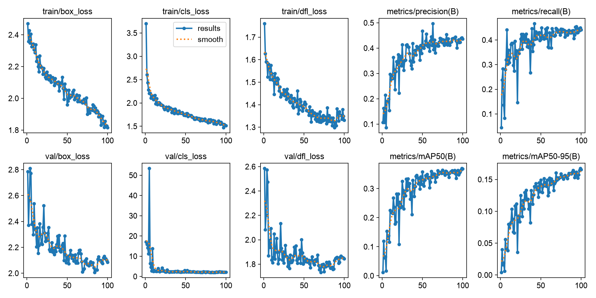
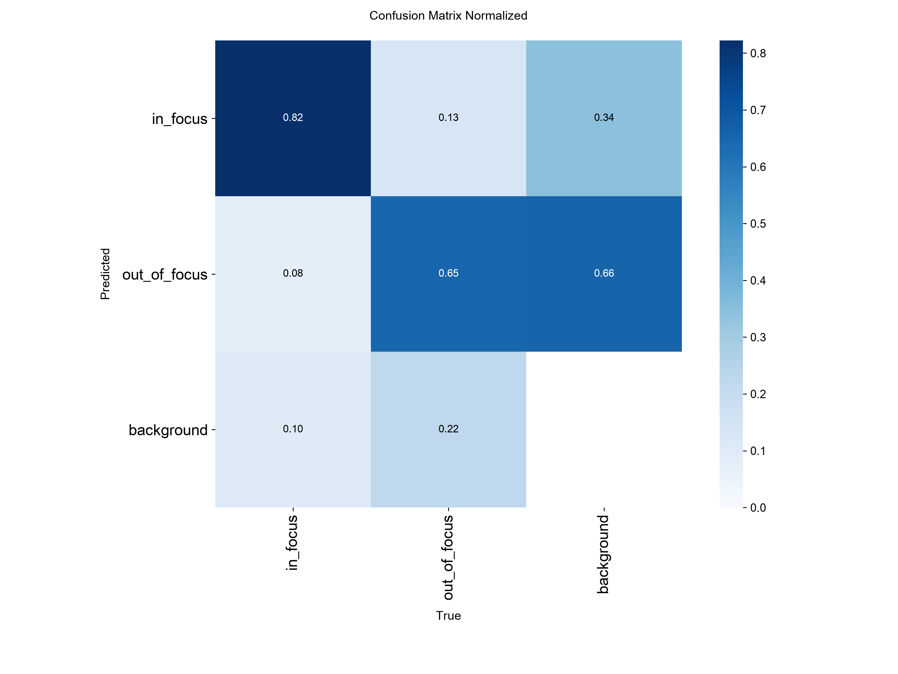
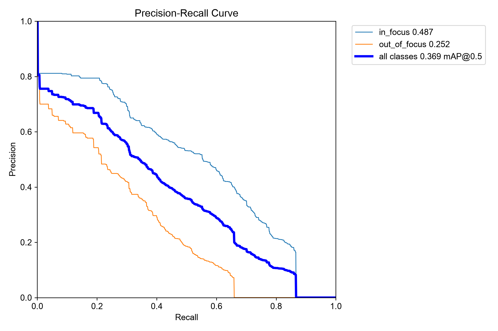

# In-focus / out-of-focus bacteria detector (YOLO11)

A YOLO11 detector that finds *Sporosarcina pasteurii* cells in bright-field microscopy videos and tells
**in-focus** cells (sharp, dark rods in the focal plane) from **out-of-focus** ones (blurry, bright halos).
It is the filtering stage of the life-cycle project: the self-supervised model downstream should only see
cells that are actually in focus.

The growth stage is **never** labeled. Focus is the only manual annotation in the project.

**Best result, exponential phase (×40):** mAP50 **0.50** for in-focus cells, precision 0.48, recall 0.61.

## Pipeline

1. **Preprocessing (pipeline v2, `../Phase_Extraction_v2/`).**
   - Per-frame brightness normalization: the lamp level jumps during acquisition, up to ±40 gray levels.
     After normalization, the residual offset is about ±0.5 %.
   - Masked-mean background estimated from 200 frames sampled over the video, since the videos do not fit in memory.
   - Difference-of-Gaussians filter, tuned to the cell width.
   - Threshold-free shapes, from DoG sign regions split by a masked watershed.
2. **Labeling tasks (`Make_Labeling_Tasks.py`).**
   - 640 × 640 tiles at full resolution. YOLO resizes its input to 640 px, so a whole ×100 frame would shrink
     the cells from 18 to about 3 px.
   - Boxes pre-drawn from the v2 shapes, then checked and corrected by hand in Label Studio.
3. **Extra labeling batches.**
   - `Add_Labeling_Tasks.py`: tiles chosen for their in-focus content.
   - `Make_Frame_Tasks_1080p.py`: whole ×100 frames downscaled by area averaging to the ×40 pixel scale.
4. **Training and evaluation (`Train_YOLO.ipynb`).**
   - Builds the dataset from a snapshot of the Label Studio database.
   - Train / validation split by source frame, with a fixed list of validation frames so that runs stay comparable.
   - Trains the model, then scores it overall and per video, which checks for a magnification shortcut.

## Data

Two time-lapse videos from the EPFL Center for Imaging. Neither the data nor the trained weights are published.

| Video | Growth phase | Magnification | Frame size | Cell width |
|---|---|---|---|---|
| Expo | exponential | ×40 | 1920 × 1080 | ~7 px |
| Stationary | stationary | ×100 (×40 part excluded) | 3584 × 2746 | ~18 px |

Hand-labeled boxes in dataset v2:

| Split | Video | Tiles | in_focus | out_of_focus |
|---|---|---|---|---|
| train | Expo | 53 | 2279 | 1369 |
| train | Stationary | 240 | 274 | 601 |
| val | Expo | 18 | 497 | 415 |
| val | Stationary | 60 | 21 | 148 |

## Training

`yolo11n`, pretrained on COCO, fine-tuned for 100 epochs at 640 px on an Apple GPU (`mps`), batch 16, seed 0.

- Color augmentations are off, since the images are grayscale.
- Flips are on, horizontal and vertical, since a cell has no up or down.
- The full configuration is in [`results/v2_yolo11n/args.yaml`](results/v2_yolo11n/args.yaml).

## Results (validation set, best epoch)

| Validation set | Class | Precision | Recall | mAP50 | mAP50-95 |
|---|---|---|---|---|---|
| **Expo (×40)** | **in_focus** | **0.479** | **0.606** | **0.503** | **0.252** |
| Expo (×40) | out_of_focus | 0.432 | 0.320 | 0.281 | 0.097 |
| Stationary (×100) | in_focus | 0.360 | 0.190 | 0.197 | 0.080 |
| Stationary (×100) | out_of_focus | 0.463 | 0.223 | 0.239 | 0.103 |
| All | both | — | — | 0.369 | 0.167 |

Raw numbers are in [`results/v2_yolo11n/scores_per_video.csv`](results/v2_yolo11n/scores_per_video.csv) and the per-epoch log in
[`results/v2_yolo11n/results.csv`](results/v2_yolo11n/results.csv). The previous run (v1b, before the second labeling batch) is in
[`results/v1b_scores_per_video.csv`](results/v1b_scores_per_video.csv).

| Training curves | Normalized confusion matrix | Precision-recall |
|---|---|---|
|  |  |  |

### Reading the results

- **In-focus cells are the reliable class.** On the whole validation set, 82 % of the labeled in-focus cells are
  detected with the right class, at the confusion matrix's default confidence of 0.25. Of the rest, 8 % are
  called out-of-focus and 10 % are missed.
- **Out-of-focus recall is the weak point**, at about 0.32: very blurry cells are often missed or confused with
  background.
- **The model does not exploit magnification.** The ×100 video is not easier than the ×40 one, so the classifier
  does not use cell size as a shortcut.
- **The Stationary in-focus score is not conclusive.** It rests on 21 validation boxes, so one cell is worth
  about 5 % of recall.
- **Adding 153 in-focus training boxes to Stationary (v1b → v2) did not measurably change it.** Over the same
  run, Expo in-focus rose from 0.471 to 0.503.

## Lessons learned

- **Pre-drawing boxes from classical image processing works at ×40 but not at ×100.** The DoG proposals had to be
  removed in large numbers on the stationary video.
- **Tiling at full resolution keeps small objects detectable.** It also makes labeling harder: most ×100 tiles are
  background. The next step was whole frames rescaled to a common pixel scale.
- **The validation set has to be sized for the rarest class before labeling effort can be measured.**

## Reproduce

```bash
python Make_Labeling_Tasks.py        # tiles + Label Studio tasks with pre-drawn boxes
zsh start_label_studio.sh            # label in Label Studio (local files)
jupyter nbconvert --to notebook --execute Train_YOLO.ipynb   # dataset export, training, per-video scores
```

Paths to the source videos, the Label Studio database and the output folders are set in the CONFIG block of each script.
